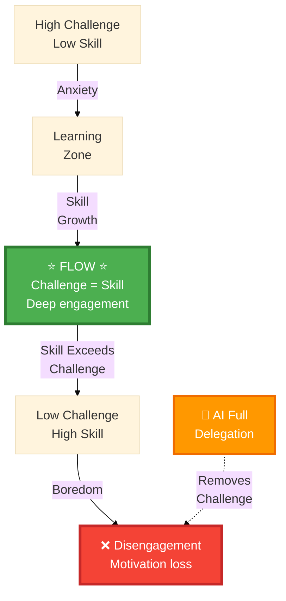

# Flow State: The Joy

Csikszentmihalyi's flow concept: optimal experience when challenge meets skill.

Time disappears. Deep engagement.

This is why we love coding.

::right::

<v-click>

</v-click>
